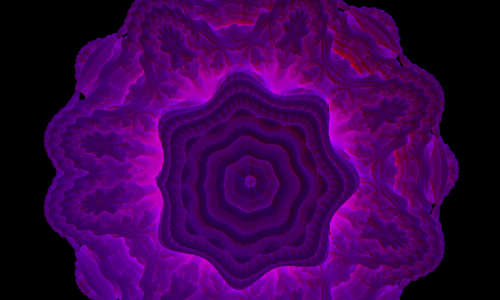
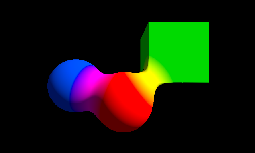
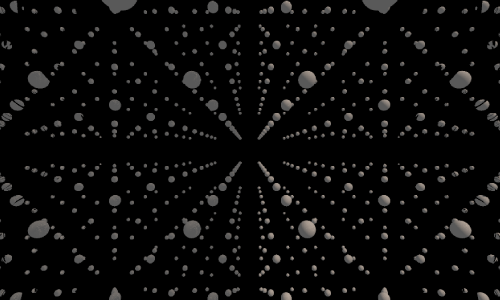

# Raymarching Project

A Unity project exploring real-time raymarching with the Universal Render Pipeline. It contains the following features:

- **Raymarched shapes:** Sphere and cube distance fields with smooth blending, optional tiling, directional-light shadows, and ambient lighting.
- **Mandelbulb fractal:** A signed-distance estimator with lighting, iteration-based coloring, and animated fractal power while playing.

## Requirements

- **Unity 2022.3**

## Files

- `Assets/Scripts/RaymarchRendererFeature.cs` and `RaymarchRenderPass.cs` set up the shape render pass and provide scene shape data to the GPU.
- `Assets/Scripts/RaymarchFractalRendererFeature.cs` and `RaymarchFractalRenderPass.cs` set up the fractal render pass.
- `Assets/Shaders/RaymarchShapes.shader` raymarches the scene's sphere and cube distance fields.
- `Assets/Shaders/RaymarchFractal.shader` implements the Mandelbulb distance estimator and raymarching.
- `Assets/Shaders/RaymarchCommon.hlsl` and `ColorUtils.hlsl` contain shared blending and color functions.